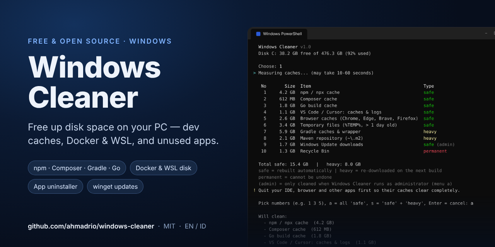
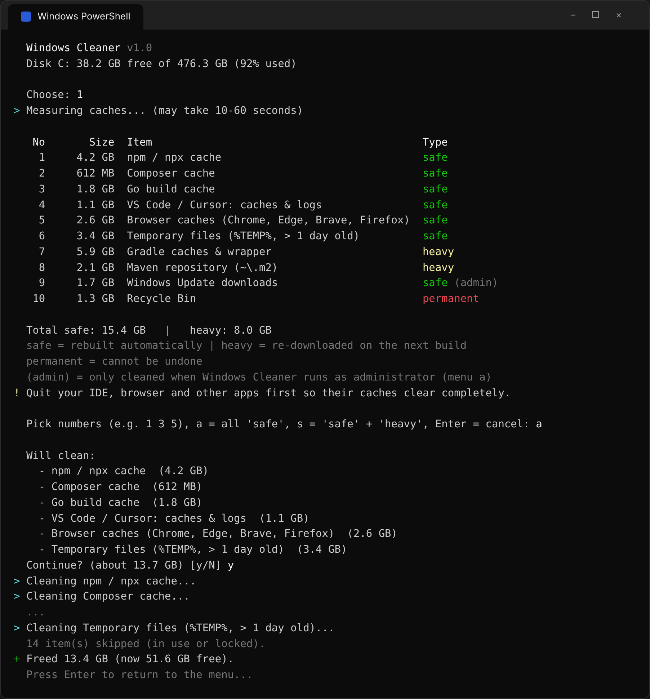

# Windows Cleaner

**Free, open-source disk cleaner for Windows — built with developers in mind.**
One interactive PowerShell script, no install, no dependencies, no admin required. English & Bahasa Indonesia.

🇮🇩 [Baca dalam Bahasa Indonesia](#bahasa-indonesia) · 🍎 On a Mac? Use [Mac Cleaner](https://github.com/ahmadrio/mac-cleaner)

- 🧹 **Clean caches** — npm, Yarn, pnpm, Bun, Composer, pip, uv, Go, Gradle, Maven, Flutter, NuGet, Cargo, VS Code / Cursor, browsers, Temp, crash dumps, Windows Update, Recycle Bin
- 🐳 **Docker & WSL** — pick exactly which containers, images, volumes, build cache or networks to remove, clean everything unused at once, do a full reset, or **shrink the WSL / Docker Desktop disk** that never shrinks by itself
- 📦 **Find rarely used & large apps** — sorted by size, with "last opened" from Windows
- 🗑️ **Uninstall apps completely** — runs the app's own uninstaller, then moves its leftover files in AppData to the Recycle Bin
- ⬆️ **Update apps** — everything `winget` can update, in one list, plus shortcuts to Microsoft Store and Windows Update
- 🧠 **RAM** — memory load and the apps using the most memory (helpers included), quit the ones you pick, or shut down WSL to free its VM
- 📊 **Find the largest folders & app data** in your user folder and AppData, then show them in Explorer



*Screenshot uses demo data — your items and sizes will differ.*

## Quick start

Open **PowerShell** or **Windows Terminal** and paste one line (nothing is installed):

```powershell
# Try it first: shows what would be deleted, deletes nothing
& ([scriptblock]::Create((irm https://raw.githubusercontent.com/ahmadrio/windows-cleaner/main/windows-cleaner.ps1))) -DryRun

# Run for real
irm https://raw.githubusercontent.com/ahmadrio/windows-cleaner/main/windows-cleaner.ps1 | iex
```

Or keep a copy you can double-click: **Code › Download ZIP**, extract it, and double-click **`windows-cleaner.cmd`**. With Git:

```powershell
git clone https://github.com/ahmadrio/windows-cleaner.git
cd windows-cleaner
.\windows-cleaner.cmd
```

### Options

| Option | What it does |
| --- | --- |
| `-DryRun`, `-n` | Show what would be deleted without deleting anything |
| `-Lang en` / `-Lang id` | Force English or Bahasa Indonesia |
| `-Help` | Show help |

The language follows your Windows display language. Switch it any time with **`l`** in the main menu — your choice is remembered (`%APPDATA%\windows-cleaner\lang`). You can also set `WINDOWS_CLEANER_LANG=en|id`.

### Administrator mode (optional)

Everything works as a normal user. A few extras need admin rights: the Windows Update download cache, `C:\Windows\Temp`, Delivery Optimization files, shrinking WSL disks, and more complete "last opened" data. Press **`a`** in the main menu to reopen Windows Cleaner as administrator (when it runs from a file), or open **Terminal (Admin)** and run the one-liner again.

## What gets cleaned

Every item shows its size first and only runs after you confirm. Items are labelled:

- **safe** — rebuilt automatically when needed
- **heavy** — re-downloaded on your next build (needs internet, first build is slower)
- **permanent** — cannot be undone (emptying the Recycle Bin)

| Item | Location / command | Type |
| --- | --- | --- |
| npm / npx | `%LOCALAPPDATA%\npm-cache\_cacache`, `_npx`, `_logs` | safe |
| Yarn | `%LOCALAPPDATA%\Yarn\Cache`, `~\.yarn\berry\cache` | safe |
| pnpm | `pnpm store prune` (only unreferenced packages) | safe |
| Bun | `~\.bun\install\cache` | safe |
| Composer | `%LOCALAPPDATA%\Composer` | safe |
| pip / uv | `%LOCALAPPDATA%\pip\Cache`, `%LOCALAPPDATA%\uv\cache` | safe |
| Go build cache | `go env GOCACHE` | safe |
| VS Code / Cursor | `Cache`, `CachedData`, `CachedExtensionVSIXs`, `Code Cache`, `GPUCache`, `logs` in `%APPDATA%\Code` (and Insiders, Cursor, Windsurf) | safe |
| Browsers | `Cache`, `Code Cache`, `GPUCache` of every Chrome, Edge, Brave and Vivaldi profile; Firefox `cache2`. Logins, history and cookies are not touched | safe |
| Temporary files | `%TEMP%` — only items older than 1 day; files in use are skipped | safe |
| Crash dumps | `%LOCALAPPDATA%\CrashDumps`, Windows Error Reporting archive & queue | safe |
| Gradle | `~\.gradle\caches`, `~\.gradle\wrapper\dists` | heavy |
| Maven | `~\.m2\repository` | heavy |
| Go modules | `go clean -modcache` | heavy |
| Dart / Flutter | `%LOCALAPPDATA%\Pub\Cache\hosted`, `git` | heavy |
| NuGet | `~\.nuget\packages`, `%LOCALAPPDATA%\NuGet\v3-cache` | heavy |
| Cargo | `~\.cargo\registry\cache`, `src` | heavy |
| Playwright & `~\.cache` | `%LOCALAPPDATA%\ms-playwright`, Puppeteer and other CLI caches | heavy |
| Windows Update *(admin)* | `C:\Windows\SoftwareDistribution\Download` (the update service is paused while cleaning) | safe |
| Windows\Temp *(admin)* | `C:\Windows\Temp` — only items older than 1 day | safe |
| Delivery Optimization *(admin)* | `Delete-DeliveryOptimizationCache` | safe |
| Recycle Bin | `Clear-RecycleBin` | permanent |

### Docker & WSL

**Pick by type** — each one lists the items first so you can choose numbers:

| Option | What you see / can pick |
| --- | --- |
| 1. Container | name, status (running / exited), size · pick numbers or `s` = all stopped. Running ones are stopped first. |
| 2. Image | size, status (**in use** / unused / dangling), age · pick numbers, `u` = all unused, `d` = dangling only. Images in use are skipped. |
| 3. Volume | size and which container uses it · pick numbers or `u` = all unused; type `DELETE` to confirm. Volumes in use are skipped. |
| 4. Build cache | remove all, or only cache older than 7 days |
| 5. Network | remove unused custom networks (`bridge`/`host`/`none` are kept) |

**All at once:**

6. **Quick clean (safe)** — stopped containers, dangling images, unused networks, build cache. Volumes are not touched.
7. **Remove everything unused** — also all unused images and **all unused volumes**; type `DELETE`. ⚠️ Includes database volumes of projects stopped with `docker compose down`.
8. **Delete ALL Docker data** — every container (even running), image, volume, network and build cache; type `RESET`.
9. **Shrink the WSL / Docker Desktop disk** *(admin)* — WSL 2 and Docker Desktop store everything in `.vhdx` files that grow but never give space back. This lists every disk with its size, shuts WSL down, and compacts the ones you pick (with `Optimize-VHD` when Hyper-V tools are installed, otherwise `diskpart`, which also works on Windows Home). Run a Docker cleanup (6 or 7) first for the best result. Docker Desktop must be quit first.

Option 9 also works without Docker, for plain WSL distros.

## Uninstalling apps

Menu **4** (or pick an app straight from the rarely-used list in menu **3**). Search by name, pick an app, and Windows Cleaner shows the app, its size and install folder, plus the leftover folders it would clean up.

- The app is removed by **its own uninstaller** (the same one *Settings › Apps* uses), so services, shortcuts and registry entries are cleaned up the way the vendor intended. Windows may ask for admin permission.
- After the uninstaller finishes, Windows Cleaner checks the app is really gone, then looks again for leftovers in `AppData\Local`, `AppData\Roaming`, `AppData\LocalLow` and `AppData\Local\Programs` — folders named exactly like the app, its install folder, or `Publisher\App` — and moves them to the **Recycle Bin**. Choose `a` to run only the uninstaller.
- Folders that belong to **another installed app** are never included, and shared names (`Microsoft`, `Python`, `Docker`, `JetBrains`…) are skipped. If two copies of the same app are installed, leftovers are not touched.
- Leftovers in `ProgramData` are **shown but not removed**.
- Microsoft Store apps are not listed; remove them in *Settings › Apps › Installed apps*.

**"Last opened"** (menu 3) comes from what Windows records when you start a program from Start, the taskbar or Explorer. Running as administrator adds Prefetch data, which also covers apps started in other ways.

## Updating apps

Menu **6** runs `winget upgrade` and shows one list with the installed and latest version and the source (`winget` or `msstore`). Pick numbers or `a` for everything; each app is updated with `winget upgrade --id <id> --exact`, so winget can still show licences or ask for admin rights. Nothing is updated before you confirm.

- `s` opens Microsoft Store updates, `w` opens Windows Update.
- The list is read with `--accept-source-agreements` (the terms for using winget's catalogs), so the check doesn't stop at a hidden prompt the first time.
- No winget? Install **App Installer** from the Microsoft Store. Scoop or Chocolatey users can keep using `scoop update *` / `choco upgrade all`.

## RAM

Menu **7** shows how your memory is really doing and what's using it:

- **Memory load** (normal / warning / critical), based on available memory and commit charge, plus available, standby cache, compressed and committed memory — the same numbers as Task Manager.
- **The apps using the most RAM**, measured like Task Manager (private working set) with all processes of the same app added up (all of Chrome's processes count as "Google Chrome"). Heavy background processes (`node`, `java`, databases, and the WSL/Docker VM `vmmem`) are listed too.
- **Quit the apps you pick.** Apps are asked to close normally, like clicking ✕, so they offer to save unsaved work. Windows parts and the terminal you're running Windows Cleaner in are never offered.
- **`w` runs `wsl --shutdown`**, which gives the memory of WSL and Docker Desktop's VM back to Windows.

A note on "RAM cleaners": Windows deliberately keeps free RAM filled with standby cache, because unused RAM is wasted RAM, so a high "used" number is normal. What slows a PC down is running out of available memory. When the load is yellow or red, quitting the heaviest apps is what actually helps, and that's what this menu is built around.

## Safety

- No admin rights needed. As a normal user the script only deletes inside your user folder, and only the **contents** of known cache folders. As administrator it also clears the Windows Update cache and `C:\Windows\Temp`. Anything else is done by each tool's own command (`pnpm store prune`, `go clean`, `docker … prune`, `winget`).
- Junctions and symbolic links are removed as links — their targets are never followed or deleted.
- Never touched: Desktop, Documents, Downloads, Pictures, Music, Videos, OneDrive, `~\.ssh`, your projects.
- Leftovers of uninstalled apps are **moved to the Recycle Bin** (recoverable), never deleted directly.
- Use `-DryRun` first to see exactly what would happen.

## Requirements

- Windows 10 or 11. Runs on the built-in Windows PowerShell 5.1 — nothing to install. PowerShell 7 works too.
- Tools such as `pnpm`, `go`, `docker`, `wsl` and `winget` are detected automatically; missing ones are simply skipped.

## FAQ

**"Running scripts is disabled on this system."** Use the `irm` one-liner or double-click `windows-cleaner.cmd` — both run the script for this session only and don't change your settings. From a terminal: `powershell -ExecutionPolicy Bypass -File .\windows-cleaner.ps1`.

**"Windows protected your PC" when double-clicking.** Files downloaded with a browser are marked as coming from the internet. Click *More info › Run anyway*, or right-click the ZIP before extracting › *Properties* › *Unblock*.

**Free space didn't go up as much as shown.** Files that are in use are skipped (close your browser and IDE first), and apps uninstalled from menu 3/4 sit in the Recycle Bin until you empty it.

**An app shows "never recorded".** Windows has no record of it being opened from Start, the taskbar or Explorer. Run as administrator to include Prefetch data.

**WSL disk didn't shrink much.** Compacting only returns space that is already free inside the disk. Remove what you don't need first (menu 2, options 6–7, or inside your distro), then compact again.

## Contributing

Issues and pull requests are welcome — especially new cache locations, translations, and bug reports with the output of `-DryRun`. Please keep it a single dependency-free script that runs on Windows PowerShell 5.1.

## License

[MIT](LICENSE) © Ahmad Rio. Provided as is, without warranty — review what you delete.

---

## Bahasa Indonesia

**Aplikasi pembersih disk gratis & open source untuk Windows — dibuat dengan kebutuhan developer.**
Satu script PowerShell interaktif, tanpa instalasi, tanpa dependency, tanpa perlu admin. Tersedia dalam Bahasa Indonesia & English.

- 🧹 **Bersihkan cache** — npm, Yarn, pnpm, Bun, Composer, pip, uv, Go, Gradle, Maven, Flutter, NuGet, Cargo, VS Code / Cursor, browser, Temp, crash dump, Windows Update, Recycle Bin
- 🐳 **Docker & WSL** — pilih sendiri container, image, volume, build cache, atau network yang mau dihapus, bersihkan semua yang tak terpakai sekaligus, full reset, atau **kecilkan disk WSL / Docker Desktop** yang tidak pernah mengecil sendiri
- 📦 **Cari aplikasi jarang dipakai & paling besar** — urut dari yang terbesar, lengkap dengan "terakhir dibuka"
- 🗑️ **Uninstall aplikasi sampai bersih** — menjalankan uninstaller bawaan aplikasinya, lalu file sisanya di AppData dipindah ke Recycle Bin
- ⬆️ **Update aplikasi** — semua yang bisa diupdate `winget` dalam satu daftar, plus pintasan ke Microsoft Store dan Windows Update
- 🧠 **RAM** — beban memori dan aplikasi yang paling boros RAM (termasuk proses pendukungnya), tutup yang Anda pilih, atau matikan WSL supaya RAM VM-nya kembali
- 📊 **Cari folder & data aplikasi terbesar** di folder user dan AppData, lalu tampilkan di Explorer

*Tangkapan layar memakai data demo — item dan ukuran di PC Anda akan berbeda.*

### Cara pakai

Buka **PowerShell** atau **Windows Terminal**, lalu tempel satu baris (tidak ada yang diinstal):

```powershell
# Coba dulu: tampilkan apa yang akan dihapus, tanpa menghapus apa pun
& ([scriptblock]::Create((irm https://raw.githubusercontent.com/ahmadrio/windows-cleaner/main/windows-cleaner.ps1))) -DryRun -Lang id

# Jalankan sungguhan
& ([scriptblock]::Create((irm https://raw.githubusercontent.com/ahmadrio/windows-cleaner/main/windows-cleaner.ps1))) -Lang id
```

Atau simpan supaya bisa di-double-click: **Code › Download ZIP**, extract, lalu double-click **`windows-cleaner.cmd`**.

**Bahasa:** otomatis mengikuti bahasa tampilan Windows. Ganti kapan saja dengan menekan **`l`** di menu utama — pilihan Anda disimpan.

**Mode administrator (opsional):** semua fitur jalan sebagai user biasa. Cache Windows Update, `C:\Windows\Temp`, Delivery Optimization, compact disk WSL, dan data "terakhir dibuka" yang lebih lengkap butuh hak admin — tekan **`a`** di menu utama, atau buka **Terminal (Admin)** lalu jalankan perintahnya lagi.

### Yang dibersihkan

Setiap item ditampilkan ukurannya dulu dan baru dijalankan setelah Anda konfirmasi. Labelnya:

- **aman** — dibuat ulang otomatis saat dibutuhkan
- **berat** — di-download ulang saat build berikutnya (perlu internet, build pertama lebih lama)
- **permanen** — tidak bisa dikembalikan (mengosongkan Recycle Bin)

Daftar lengkap lokasi ada di tabel [What gets cleaned](#what-gets-cleaned) di atas. Cache browser hanya cache-nya saja — login, riwayat, dan cookie tidak disentuh. File Temp hanya yang lebih lama dari 1 hari.

**Docker — pilih per jenis** (daftar item ditampilkan dulu, lalu pilih nomornya): (1) container, (2) image, (3) volume — ketik `HAPUS`, (4) build cache, (5) network. **Sekaligus:** (6) bersihkan cepat (aman) — volume tidak disentuh; (7) hapus semua yang tak dipakai termasuk volume — ketik `HAPUS`, ⚠️ termasuk volume database proyek yang sudah `docker compose down`; (8) hapus SEMUA data Docker — ketik `RESET`; (9) **kecilkan disk WSL / Docker Desktop** (admin) — WSL dimatikan dulu, lalu file `.vhdx` di-compact. Jalankan pembersihan Docker (6/7) dulu supaya hasilnya maksimal.

### Uninstall aplikasi

Pakai menu **4** (atau pilih langsung dari daftar aplikasi jarang dipakai di menu **3**).

- Aplikasi dihapus dengan **uninstaller bawaannya** (sama seperti lewat *Settings › Apps*). Windows mungkin meminta izin admin.
- Setelah uninstaller selesai, Windows Cleaner memastikan aplikasinya benar-benar terhapus, lalu file sisanya di `AppData` (folder yang namanya persis sama dengan aplikasi, folder instalasinya, atau `Publisher\Aplikasi`) dipindah ke **Recycle Bin**. Pilih `a` untuk menjalankan uninstaller saja.
- Folder milik **aplikasi lain yang masih terpasang** tidak pernah ikut, dan nama umum (`Microsoft`, `Python`, `Docker`, `JetBrains`…) dilewati.
- Sisa di `ProgramData` hanya **ditampilkan, tidak dihapus**. Aplikasi Microsoft Store tidak ditampilkan — hapus lewat *Settings › Apps*.

### Update aplikasi & RAM

- Menu **6** menjalankan `winget upgrade`, menampilkan versi terpasang dan terbaru, lalu mengupdate yang Anda pilih. `s` membuka update Microsoft Store, `w` membuka Windows Update.
- Menu **7** menampilkan beban memori (normal / peringatan / kritis) dan aplikasi yang paling boros RAM seperti di Task Manager. Aplikasi ditutup secara normal, jadi tetap menawarkan untuk menyimpan pekerjaan. `w` menjalankan `wsl --shutdown` untuk mengembalikan RAM VM WSL/Docker.

Catatan soal "pembersih RAM": Windows sengaja mengisi RAM kosong dengan cache (standby), jadi angka "terpakai" yang tinggi itu normal. Yang membuat PC lambat adalah memori yang tersedia hampir habis. Kalau kuning atau merah, menutup aplikasi yang paling berat adalah cara yang benar-benar membantu.

### Keamanan

- Tanpa hak admin. Sebagai user biasa, script ini hanya menghapus di dalam folder user Anda, dan hanya **isi** folder cache yang dikenal. Junction dan symlink dihapus sebagai link saja — targetnya tidak pernah disentuh.
- Tidak pernah disentuh: Desktop, Documents, Downloads, Pictures, Music, Videos, OneDrive, `~\.ssh`, proyek Anda.
- File sisa aplikasi yang di-uninstall **dipindah ke Recycle Bin** (bisa dikembalikan).
- Pakai `-DryRun` dulu untuk melihat persis apa yang akan terjadi.

### Pertanyaan umum

- **"Running scripts is disabled on this system"?** Pakai perintah `irm` di atas atau double-click `windows-cleaner.cmd` — keduanya hanya berlaku untuk sesi itu dan tidak mengubah setting Anda.
- **Muncul "Windows protected your PC"?** Klik *More info › Run anyway*, atau klik kanan ZIP sebelum di-extract › *Properties* › *Unblock*.
- **Ruang kosong tidak bertambah sebanyak yang ditampilkan?** File yang sedang dipakai dilewati (tutup browser & IDE dulu), dan aplikasi yang di-uninstall masih ada di Recycle Bin sampai dikosongkan.
- **Aplikasi "tidak tercatat"?** Windows tidak punya catatan aplikasi itu dibuka dari Start, taskbar, atau Explorer. Jalankan sebagai admin supaya data Prefetch ikut dibaca.

### Kontribusi

Issue dan pull request sangat diterima — terutama lokasi cache baru, terjemahan, dan laporan bug (sertakan output `-DryRun`).

### Lisensi

[MIT](LICENSE) © Ahmad Rio. Gratis untuk dipakai, diubah, dan dibagikan. Disediakan apa adanya — periksa dulu apa yang Anda hapus.
